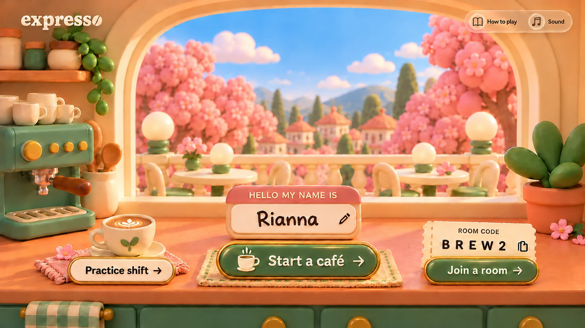
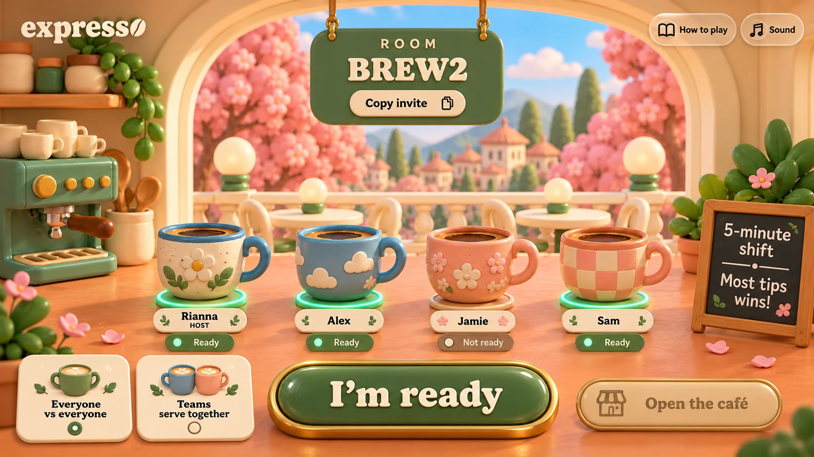
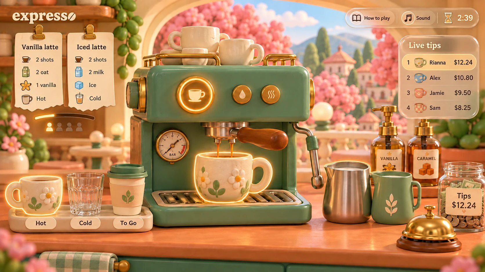
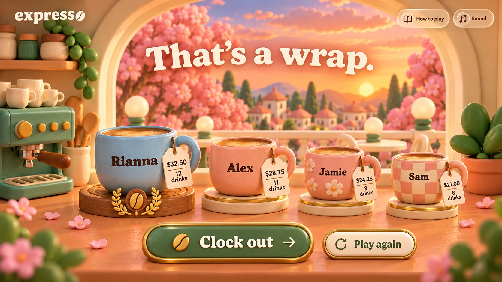

# expresso

A multiplayer café game for 2–8 players. Prepare drinks during a five-minute shift; the biggest tip jar wins. Play everyone vs everyone, or work together in equal-sized teams. Solo practice is also available.

## How to play

### 1. Start or join

Enter your barista name, start a café, or enter a friend's room code. Choose **Practice shift** to learn on your own.



### 2. Get ready

Click **Copy code** and share the five-character code. The host picks a mode; in Teams, choose Blue or Peach. Ready players' coasters light up. Once everyone is ready and teams are balanced, the host opens the café.



### 3. Make drinks

Claim a clipped ticket. Its ingredient pictures show the recipe. Select a cup, press the machine's brew button, then click the milk pitcher and syrup pump you need. Each click adds one portion; each espresso shot takes 2.5 seconds. Use the ice and trash buttons beside Brew to add ice or clear the cup, then ring the bell to serve. Hot, cold, and to-go cups are distinct choices, with one of each in every three consecutive orders. To-go cups are open during preparation. Click a claimed ticket again to release it without clearing the drink.

A new ticket arrives immediately after serving. Customers wait 90 seconds. Accurate, fast drinks earn higher tips; expired tickets earn nothing. The live leaderboard tracks every café. In Teams, **Pass to teammate** keeps the unfinished drink intact.



### 4. Clock out

The highest tips win; equal tips share the win. Review the mug podium, clock out, or let the host reopen the lobby for another shift.



The images above are the approved visual design references, not captured browser screenshots. The playable interface recreates the scene with live names, tickets, readiness lights, scores, and controls.

## Run locally

Requires Node.js 22 or newer. No dependency installation is required.

```sh
git pull origin main
npm start
```

Open http://localhost:3000. After backend updates, stop the old process with Ctrl+C and run `npm start` again. `npm run dev` restarts the server automatically when server files change. Rooms reset on restart.

## Practice

Choose **Practice shift** on the landing page, ready up, and open the café. **Exit practice** in the top bar returns to the landing page immediately, even during a shift.

## GitHub Pages

The Pages build runs solo practice entirely in the browser, including brewing, recipes, timers and scoring. Multiplayer room hosting and joining require the Node server.

1. In this repository, open **Settings → Pages** and choose **GitHub Actions** as the source.
2. In **Actions**, run **Deploy practice to GitHub Pages**, or push to `main`.
3. After the workflow succeeds, open https://riannazhu.github.io/expresso/ and choose **Practice shift**.

The workflow tests the game, builds `dist/`, and publishes it. Browser practice saves its room state locally so refreshes can resume a shift.

To inspect the static build locally:

```sh
node scripts/build-pages.mjs
python3 -m http.server 8080 --directory dist
```

## Multiplayer hosting

Run the included Node server on a host such as Render, using `render.yaml`, or build the Dockerfile. Rooms live in one server's memory, so use one instance. See [deployment and development](docs/DEVELOPMENT.md) for details.

## Checks

```sh
npm test
npm run check
```
